.. _flync_example:

FLYNC Examples
==============
Welcome to the configuration examples and tutorials! This section walks you through practical usage of the ``FLYNC`` configuration system with real examples.
The ``examples/`` folder of the FLYNC repository contains complete, validating workspaces you can read, copy and
adapt.

Choosing an example
-------------------

.. list-table::
   :header-rows: 1
   :widths: 22 46 32

   * - Example
     - Use it when you need
     - Validate with
   * - :ref:`flync_example <example_base>`
     - A complete, realistic reference vehicle network (ECU modeling, Commuincation Protocols, Topologies, ...).
     - ``flync validate examples/flync_example``
   * - :ref:`flync_example_experimental <example_experimental>`
     - The base example plus features that are currently marked experimental . Subject to change.
     - ``flync validate examples/flync_example_experimental``
   * - :ref:`can_lin_example <example_can_lin>`
     - A minimal workspace with one CAN FD bus, one LIN bus and their PDUs.
     - ``flync validate examples/can_lin_example``
   * - :ref:`ecu_variants <example_ecu_variants>`
     - Various ECU examples with different internal structures, e.g. one/multiple controllers, external/integrated PHYs, and several more complex structures using Switches, VMs, or compute nodes.
     - ``flync validate --node ECU examples/ecu_variants/<variant>``
   * - :ref:`flync_4_variability <example_variability>`
     - Product variants: optional ECUs and alternative architectures in one workspace.
     - ``flync validate examples/flync_4_variability/<case>``

Example workspaces
------------------

.. _example_base:

flync_example (Base Example)
""""""""""""""""""""""""""""

**Path:** `examples/flync_example <https://github.com/Technica-Engineering/FLYNC/tree/main/examples/flync_example>`_

The reference configuration for a vehicle network. Start here if you want to see how the pieces fit together.
It contains 16 ECUs, Ethernet, CAN, LIN and J1939 buses, SOME/IP services, PDU containers, network management,
time synchronization, MACsec and TSN settings, and measurement points.

**Validate:** ``flync validate examples/flync_example`` (result: ``VALID``)

The following sections show selected parts of this workspace.

Ethernet network topology
^^^^^^^^^^^^^^^^^^^^^^^^^

The diagram lists every ECU, the VLANs, IP addresses and multicast groups of each controller and switch, and the
links between them.

.. image:: _static/images/examples/ethernet_topology.svg
   :align: center
   :width: 1300px

QoS, Layer 2 TSN and TCAM
^^^^^^^^^^^^^^^^^^^^^^^^^

The diagram shows the HTB shaper on the Linux controllers (``eth_ecu``), the Credit-Based Shapers on switch egress
ports, the ingress stream filters, and the TCAM rules of ``z2_switch1``. Adapt the interface mappings, policies and
parameters to your hardware.

.. image:: _static/images/examples/qos.svg
   :align: center
   :width: 1300px

Time synchronization
^^^^^^^^^^^^^^^^^^^^

The diagram shows which devices are time transmitters and which are time receivers.

.. image:: _static/images/examples/ptp.svg
   :align: center
   :width: 1300px

MACsec
^^^^^^

The diagram shows which devices are MACsec peers and where secure channels protect the links.

.. image:: _static/images/examples/macsec.svg
   :align: center
   :width: 1300px

Ethernet multidrop segment (10BASE-T1S)
^^^^^^^^^^^^^^^^^^^^^^^^^^^^^^^^^^^^^^^

The rear lamps sit on a **shared single-pair segment** rather than on a link of their own. Three lamp modules and one
port of ``zonal_platform1`` share one twisted pair, and PLCA (IEEE 802.3-2022 Clause 148) gives each of them a
transmit opportunity in turn, so the medium carries no collisions.

The segment as the model derives it, with every node ordered by the transmit opportunity it holds:

.. mermaid:: _static/mermaid/multidrop_segment_rearlampsegment.mmd

The segment is a connection in the system topology, holding the cycle all four nodes must agree on and one entry
per node:

.. code-block:: yaml

   # File: examples/flync_example/topology/ethernet_topology.flync.yaml
   connections:
     - type: ethernet_multidrop
       id: RearLampSegment
       plca:
         transmit_opportunity_count: 4
         to_timer: 32
       nodes:
         - ecu_port: z1_p2
           node_id: 0
         - ecu_port: rear_lamp_left_p1
           node_id: 1
         - ecu_port: rear_lamp_center_p1
           node_id: 2
         - ecu_port: rear_lamp_right_p1
           node_id: 3

``zonal_platform1`` holds transmit opportunity 0, which makes it the **coordinator** that emits the BEACON opening
each cycle; the three lamps hold 1 to 3 as **followers**. What differs per node beyond that, the PHY and the burst
parameters, stays on the port.

Three things to notice:

    - **The segment declares no frames.** Payload takes the ordinary Ethernet path: the lamp command and status PDUs
      travel over UDP sockets on each node's ``ethernet_interfaces``, as they would on a point-to-point link.
    - **The lamp command goes out as multicast.** Every node on a shared medium hears every frame anyway, so one command
      addressed to the group lights the whole tail.
    - **Network management is node-level here.** Each node is an IP host running its own NM stack, so it holds its own
      membership; the segment itself holds none.

.. _example_experimental:

flync_example_experimental
""""""""""""""""""""""""""

**Path:** `examples/flync_example_experimental <https://github.com/Technica-Engineering/FLYNC/tree/main/examples/flync_example_experimental>`_

A superset of ``flync_example``: every file of the base example is present, plus the parts that are still being
developed and are marked as **experimental**.

**Validate:** ``flync validate examples/flync_example_experimental`` (result: ``WARNING``,
because of experimental features; this warning is expected)

.. _example_can_lin:

can_lin_example
"""""""""""""""

**Path:** `examples/can_lin_example <https://github.com/Technica-Engineering/FLYNC/tree/main/examples/can_lin_example>`_

A small workspace with no Ethernet. Use it when you need only CAN and LIN, or as a minimal starting point.

What it contains:

- ``communication/channels/can/diag_can.flync.yaml``: ``DiagCAN``, a CAN FD diagnostics bus.
- ``communication/channels/lin/body_lin.flync.yaml``: ``BodyLIN``, a LIN 2.2A body bus at 19.2 kbit/s with mirror
  frames.
- ``communication/channels/pdus/``: the PDUs packed into those frames, including the ``lin_specific`` variants.
- ``ecus/can_node``: one ECU with one controller and a CAN interface on ``DiagCAN``.

**Validate:** ``flync validate examples/can_lin_example`` (result: ``WARNING``).

.. _example_ecu_variants:

ECU variants
""""""""""""

**Path:** `examples/ecu_variants <https://github.com/Technica-Engineering/FLYNC/tree/main/examples/ecu_variants>`_

Isolated examples of different ECU structures. Each folder is a single ECU, not a full system.

**Validate:** ``flync validate --node ECU examples/ecu_variants/<variant>`` (result: ``VALID``)

ecu_variant_1_single_controller_single_iface_ext_PHY
^^^^^^^^^^^^^^^^^^^^^^^^^^^^^^^^^^^^^^^^^^^^^^^^^^^^^

This ECU has one controller with a single (virtual) interface, reaching its ECU port through an external PHY.

Path: `examples/ecu_variants/ecu_variant_1_single_controller_single_iface_ext_PHY <https://github.com/Technica-Engineering/FLYNC/tree/main/examples/ecu_variants/ecu_variant_1_single_controller_single_iface_ext_PHY>`_.

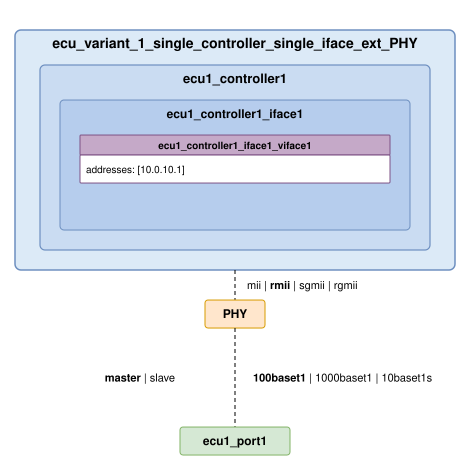

.. note:: The MDI configuration must be compliant with that of the other ECU to which the port is connected to. In this case, ``mode``, ``speed`` and ``duplex`` must match; while ``role`` must be opposite to that of the other ECU config (i.e., if slave in the connected ECU, master shall be configured).

.. note:: The MII configuration must be compliant with that of the ECU controller configuration. In this case, ``type`` and ``speed`` must match; while ``mode`` must oppose the controller interface config (i.e., if mac in the controller interface, phy shall be configured).

ecu_variant_2_single_controller_single_iface_int_PHY
^^^^^^^^^^^^^^^^^^^^^^^^^^^^^^^^^^^^^^^^^^^^^^^^^^^^^

Similar to variant 1, but with an integrated PHY.

Path: `examples/ecu_variants/ecu_variant_2_single_controller_single_iface_int_PHY <https://github.com/Technica-Engineering/FLYNC/tree/main/examples/ecu_variants/ecu_variant_2_single_controller_single_iface_int_PHY>`_.

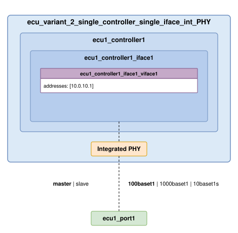

.. note:: Since PHY is integrated into the host controller, no MII configuration is needed neither on the port side, nor on the controller side.

ecu_variant_3_single_controller_multiple_iface_ext_PHY
^^^^^^^^^^^^^^^^^^^^^^^^^^^^^^^^^^^^^^^^^^^^^^^^^^^^^^^

This ECU has one controller with one interface carrying two virtual interfaces (VLAN 10 and VLAN 20), reaching its ECU port through an external PHY.

Path: `examples/ecu_variants/ecu_variant_3_single_controller_multiple_iface_ext_PHY <https://github.com/Technica-Engineering/FLYNC/tree/main/examples/ecu_variants/ecu_variant_3_single_controller_multiple_iface_ext_PHY>`_.

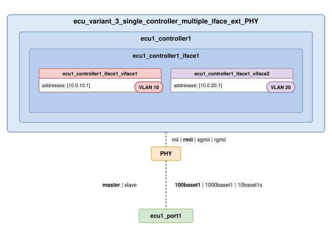

ecu_variant_4_single_controller_multiple_iface_int_PHY
^^^^^^^^^^^^^^^^^^^^^^^^^^^^^^^^^^^^^^^^^^^^^^^^^^^^^^^

Similar to variant 3, but with an integrated PHY.

Path: `examples/ecu_variants/ecu_variant_4_single_controller_multiple_iface_int_PHY <https://github.com/Technica-Engineering/FLYNC/tree/main/examples/ecu_variants/ecu_variant_4_single_controller_multiple_iface_int_PHY>`_.

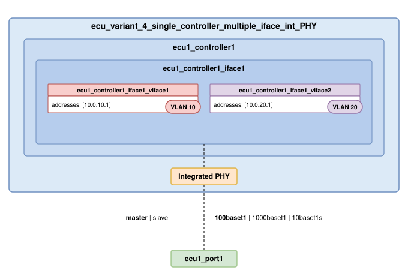

ecu_variant_5_single_controller_single_iface_multiple_vms
^^^^^^^^^^^^^^^^^^^^^^^^^^^^^^^^^^^^^^^^^^^^^^^^^^^^^^^^^^

This ECU has one controller with a single (physical) interface, shared through the virtual bridge ``br0`` by two compute nodes (VMs), with an external PHY on its ECU port.

Path: `examples/ecu_variants/ecu_variant_5_single_controller_single_iface_multiple_vms <https://github.com/Technica-Engineering/FLYNC/tree/main/examples/ecu_variants/ecu_variant_5_single_controller_single_iface_multiple_vms>`_.

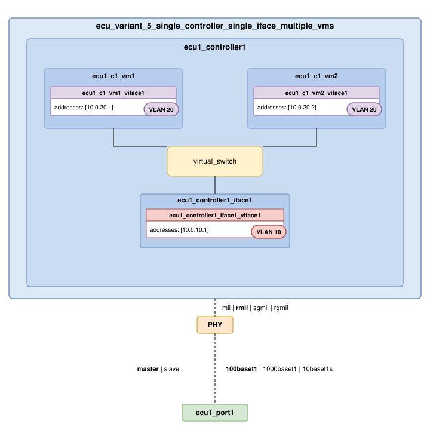

.. note:: If there is a VM, it needs to tie to a Controller Interface through a Virtual Switch.

ecu_variant_6_single_controller_multiple_iface_physical_ext_phy
^^^^^^^^^^^^^^^^^^^^^^^^^^^^^^^^^^^^^^^^^^^^^^^^^^^^^^^^^^^^^^^^

This ECU has one controller with two physical interfaces, bridged at Layer 2 by the virtual switch ``br0``, and two ECU ports, each with its own external PHY.

Path: `examples/ecu_variants/ecu_variant_6_single_controller_multiple_iface_physical_ext_phy <https://github.com/Technica-Engineering/FLYNC/tree/main/examples/ecu_variants/ecu_variant_6_single_controller_multiple_iface_physical_ext_phy>`_.

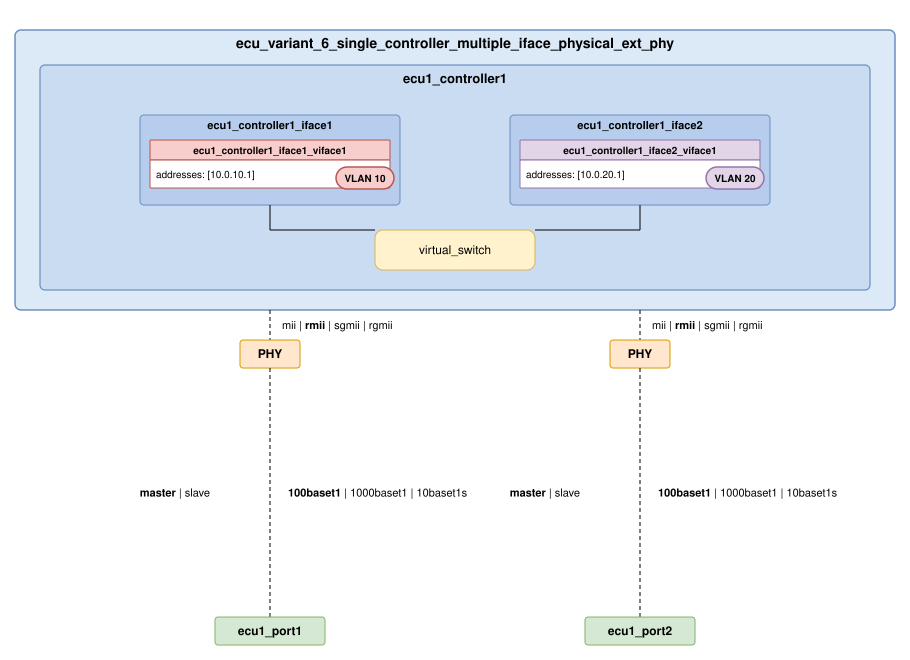

.. note:: The two controller interfaces are bridged by ``br0``, which is declared in the controller topology, not in the ECU topology.

ecu_variant_7_switch_ecu_ext_PHY
^^^^^^^^^^^^^^^^^^^^^^^^^^^^^^^^^

This ECU contains an Ethernet switch with no host controller, which uplinks to a controller interface carrying two virtual interfaces (VLAN 10 and VLAN 20) and exposes two ECU ports, each with an external PHY.

Path: `examples/ecu_variants/ecu_variant_7_switch_ecu_ext_PHY <https://github.com/Technica-Engineering/FLYNC/tree/main/examples/ecu_variants/ecu_variant_7_switch_ecu_ext_PHY>`_.

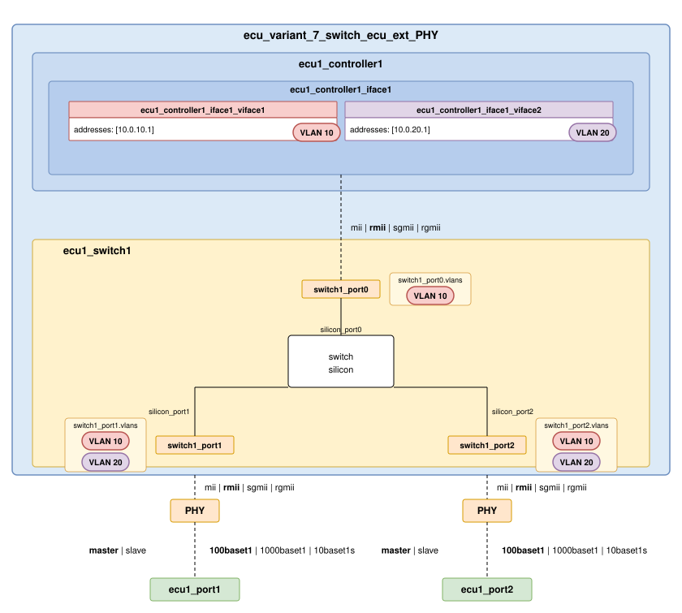

.. note:: The MII ``mode`` of the ``switch1_port0`` must oppose the one of the ``ecu1_controller1_iface1``.

ecu_variant_8_switch_ecu_with_host_ext_PHY
^^^^^^^^^^^^^^^^^^^^^^^^^^^^^^^^^^^^^^^^^^^

This ECU contains an Ethernet switch with a host controller on its CPU port, which uplinks to a controller interface carrying three virtual interfaces (VLAN 10, 20 and 30) and exposes two ECU ports, each with an external PHY.

Path: `examples/ecu_variants/ecu_variant_8_switch_ecu_with_host_ext_PHY <https://github.com/Technica-Engineering/FLYNC/tree/main/examples/ecu_variants/ecu_variant_8_switch_ecu_with_host_ext_PHY>`_.

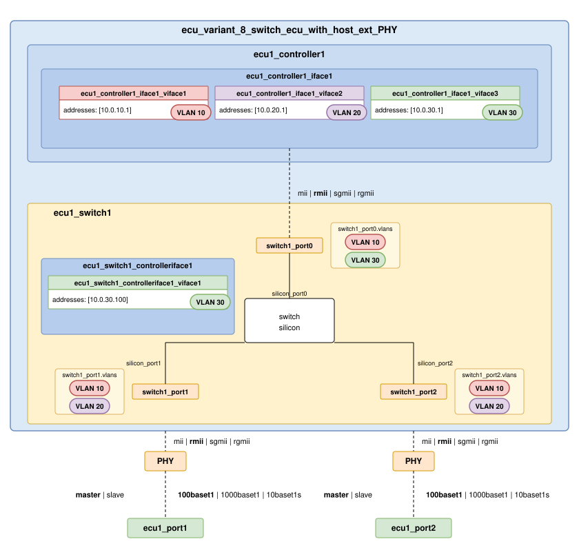

.. note:: The MII ``mode`` of the ``switch1_port0`` must **oppose** the one of the ``ecu1_controller1_iface1``.

.. note:: The Host controller of the switch will have the same configuration as any Controller Interface.

ecu_variant_9_single_controller_eth_iface_can_iface
^^^^^^^^^^^^^^^^^^^^^^^^^^^^^^^^^^^^^^^^^^^^^^^^^^^^

This ECU contains a single controller with an Ethernet interface, reaching its ECU port through an external PHY, and a CAN interface on the ``BodyCAN`` bus.

Path: `examples/ecu_variants/ecu_variant_9_single_controller_eth_iface_can_iface <https://github.com/Technica-Engineering/FLYNC/tree/main/examples/ecu_variants/ecu_variant_9_single_controller_eth_iface_can_iface>`_.

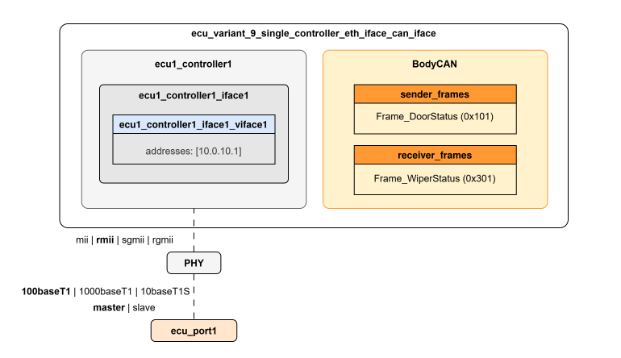

.. note:: A single controller can host a CAN interface alongside its Ethernet interface. The Ethernet interface has its own ECU port and external PHY; the CAN interface instead joins a bus via ``bus_ref`` and lists the frames it exchanges through ``sender_frames`` / ``receiver_frames``.

.. note:: Several CAN frames share the single ``BodyCAN`` bus. The frames are defined once on the bus under ``communication/channels/can/``, and the CAN interface references them by their ``frame_ref`` (the CAN identifier) together with ``id_format``.

ecu_variant_10
^^^^^^^^^^^^^^^^

This ECU contains a single controller (``adc``) with a hardware switch, five ECU ports, and five compute nodes, of which ``adaptive`` and ``diagnostic`` are nested inside ``linux_domain``.

Path: `examples/ecu_variants/ecu_variant_10 <https://github.com/Technica-Engineering/FLYNC/tree/main/examples/ecu_variants/ecu_variant_10>`_.

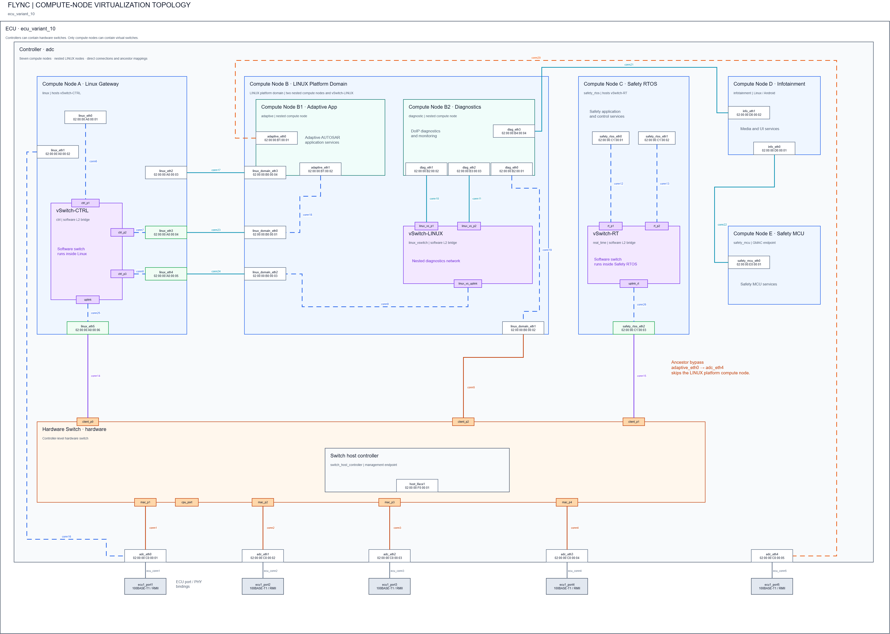

.. note:: A single controller (``adc``) hosts a hardware switch, giving the controller and its compute nodes a shared internal switching fabric alongside their Ethernet interfaces.

.. note:: Compute nodes can nest arbitrarily: the ``linux_domain`` compute node itself hosts the ``adaptive`` and ``diagnostic`` compute nodes, each with its own Ethernet interfaces. Other compute nodes of the controller (``infotainment``, ``linux``, ``safety_mcu``, ``safety_rtos``) sit alongside it at the same level.

.. note:: Compute nodes such as ``linux``, ``linux_domain`` and ``safety_rtos`` each define their own virtual switch, connecting their Ethernet interfaces independently from the controller's hardware switch.

ecu_variant_11_switch_ecu_with_port_extender
^^^^^^^^^^^^^^^^^^^^^^^^^^^^^^^^^^^^^^^^^^^^^

This ECU contains an Ethernet switch with a port extender attached to its 10G uplink, which exposes four ECU ports, and a controller interface with one virtual interface (VLAN 10).

Path: `examples/ecu_variants/ecu_variant_11_switch_ecu_with_port_extender <https://github.com/Technica-Engineering/FLYNC/tree/main/examples/ecu_variants/ecu_variant_11_switch_ecu_with_port_extender>`_.

.. image:: ./_static/images/ecu_variants/ecu_variant_11_switch_ecu_with_port_extender.svg
   :align: center
   :width: 900px

.. note:: The extender hangs off the uplink port ``switch1_uplink``. Its four ports are ports of ``ecu1_switch1``, each wired to an ECU port.

.. _example_variability:

flync_4_variability
"""""""""""""""""""

**Path:** `examples/flync_4_variability <https://github.com/Technica-Engineering/FLYNC/tree/main/examples/flync_4_variability>`_

Two complete workspaces that model product variants in one model. Each validates for every declared variant. The ``README.md`` inside explains the examples in more detail.

.. list-table::
   :header-rows: 1
   :widths: 34 66

   * - Workspace
     - What it shows
   * - ``01_optional_component``
     - One optional ECU (a rear camera) and a link that exist only in the ``park_assist`` variant. The ADAS controller
       differs between the two products.
   * - ``02_architecture_alternatives``
     - A domain and a zonal architecture, with two hardware generations of the central compute ECU. Three variants are
       declared: ``domain_gen1``, ``domain_gen2`` and ``zonal_gen2``.

**Validate and inspect:**

.. code-block:: bash

   flync validate examples/flync_4_variability/02_architecture_alternatives                  # all declared variants
   flync validate examples/flync_4_variability/02_architecture_alternatives --variant zonal_gen2
   flync variants list examples/flync_4_variability/02_architecture_alternatives            # one row per variant

The reference of the variability model is in :ref:`variability_examples`.

----------

Concepts
--------

The following sections explain FLYNC concepts with snippets. They are not separate example workspaces; where a snippet
names a real file, the file is in one of the example folders above.

Internal Topology (Configuration and Types)
""""""""""""""""""""""""""""""""""""""""""""""

An ECU with internal connections describes them in its internal topology file. An ECU without internal connections may omit the file, in which case the internal topology defaults to one without connections. In ``flync_example``, ``can_node_1`` has neither ``ports.flync.yaml`` nor ``topology.flync.yaml`` because it only attaches to a CAN bus. The following picture shows the connection types the FLYNC model supports. The snippet below uses three of them, taken from ``zonal_platform1``:

.. important:: Be aware of the kind of connection that is added to the file, since the name of the components shall adjust to it accordingly.

.. image:: ./_static/images/internal_topology/internal_topology.png
   :align: center
   :width: 1000px

.. code-block:: yaml

   # File: examples/flync_example/ecus/zonal_platform1/topology.flync.yaml
   connections:
     - type: ecu_port_to_switch_port
       id: conn1
       ecu_port: z1_p1
       switch_port: z1_s1_p0
     - type: switch_port_to_controller_interface
       id: conn2
       switch_port: z1_s1_p1
       controller_interface: z1_c1_iface1
     - type: switch_port_to_host_controller_interface
       id: conn4
       switch_port: z1_s1_cpu_port
       host_controller_interface: z1_switch1_host_iface1

Additional Security Features Configuration
""""""""""""""""""""""""""""""""""""""""""""

Firewall Configuration
^^^^^^^^^^^^^^^^^^^^^^

The Firewall model consists of a default action and three lists defining rules for input, output and forward traffic, respectively.
Each of these rules contains a pattern the packets are matched against, and an action executed when this check is positive.
The firewall belongs to an Ethernet interface, next to its ``virtual_interfaces``.

.. code-block:: yaml

   # File (illustrative): ecus/<ecu>/controllers/<controller>/ethernet_interfaces/<interface>/interface_config.flync.yaml
   firewall:
     default_action: drop
     input_rules:
       - name: allow_ssh
         action: accept
         pattern:
           src_ipv4: 10.0.0.2
           protocol: tcp
           dst_port: 22
           vlan_tagged: true
     output_rules:
       - name: drop_output_vlan_33
         action: drop
         pattern:
           dst_ipv4:
             address: 10.0.0.1
             ipv4netmask: 255.255.255.0
           vlanid: 33
     forward_rules:
       - name: allow_forwarded_udp
         action: accept
         pattern:
           src_ipv4:
             address: 10.0.0.2
             ipv4netmask: 255.255.255.0
           dst_ipv4:
             address: 10.0.0.3
             ipv4netmask: 255.255.255.0
           protocol: udp
           dst_port:
             from_value: 30490
             to_value: 30509

Switch TCAM Configuration
^^^^^^^^^^^^^^^^^^^^^^^^^^^^

.. image:: ./_static/images/tcam_rules/tcam_rules.png
   :align: center
   :width: 1000px

TCAM rules are part of the switch configuration, for example:

.. code-block:: yaml

   # File: examples/flync_example/ecus/zonal_platform2/switches/z2_switch1/switch.flync.yaml
   tcam_rules:
     - name: rule_1
       id: 1
       match_filter:
         pcp: [3, 4]
       match_ports:
         - z2_s1_p0
       action:
         - type: drop
           ports:
             - z2_s1_p2
     - name: rule_2
       id: 2
       match_filter:
         vlanid: 20
         pcp: [3, 4]
       match_ports:
         - z2_s1_p0
       vehicle_state:
         data: "0x02"
         mask: "0x0F"
       action:
         - type: vlan_overwrite
           ports:
             - z2_s1_p1
           overwrite_vlan_pcp: 1

Sockets Configuration
""""""""""""""""""""""""

A socket in FLYNC represents a logical endpoint on a virtual network interface of an ECU. It defines how the controller will send and receive traffic over a specific IP address, port, and protocol (TCP/UDP).

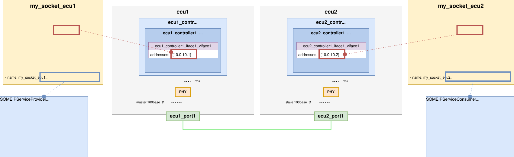

.. note:: Sockets must be defined in a separate folder for each ECU for better readability.

.. note:: Multiple sockets may be defined in a single file for different address endpoints, but they must belong to the same VLAN.

Signals
"""""""

A **Signal** is the smallest data element in the ``FLYNC`` model: a single value with its bit length, optional linear scaling (``factor`` / ``offset`` / ``unit``) and limits, and an optional ``value_encoding`` that maps raw values to labels (``text_table``, ``bitfield_text_table`` or ``bitmask_flags``). Signals are bus-agnostic and are placed into a PDU through a *signal instance* that fixes the ``bit_position`` and ``endianness``.

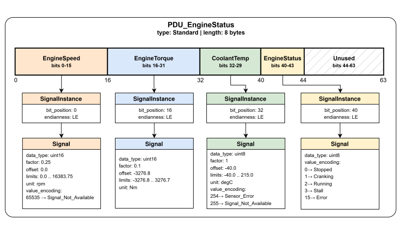

.. code-block:: yaml

   # File: examples/flync_example/communication/channels/pdus/PDU_EngineStatus.flync.yaml
   name: PDU_EngineStatus
   type: standard
   length: 8

   signals:
     - bit_position: 0
       endianness: LE

       signal:
         name: EngineSpeed
         description: Crankshaft rotational speed.
         bit_length: 16
         data_type: uint16
         factor: 0.25
         offset: 0.0
         lower_limit: 0.0
         upper_limit: 16383.75
         unit: rpm
         value_encoding:
           type: text_table
           entries:
             - value: 65535
               label: Signal_Not_Available

.. note:: Signals are defined inline inside the PDU that carries them, under ``communication/channels/pdus/``.

PDUs
""""

A **PDU** (Protocol Data Unit) is the container that groups signals for transmission. PDUs are defined independently of any bus and stored under ``communication/channels/pdus/`` (Ethernet container PDUs live in ``communication/channels/ethernet_pdu_containers/``). A frame, a socket, or another PDU then references a PDU **by name**.

Three PDU types are distinguished by the ``type`` discriminator:

- ``standard`` - a non-multiplexed PDU carrying a flat list of signal instances.
- ``multiplexed`` - a PDU with a ``selector_signal`` whose value selects which ``mux_groups`` block of signals is active on each transmission cycle.
- ``container`` - a Container PDU that packs several other PDUs into one payload, each contained PDU prefixed by a per-slot header.

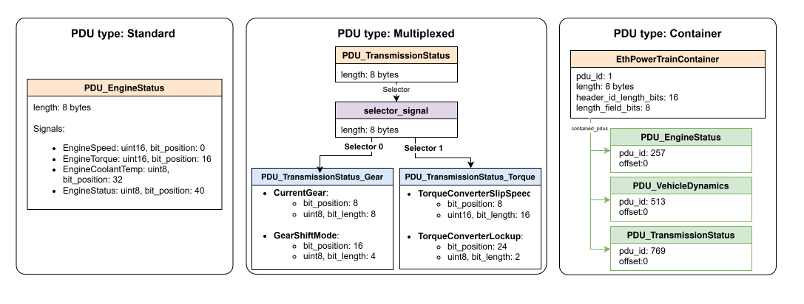

**Multiplexed PDU**

``PDU_TransmissionStatus`` multiplexes on the 4-bit ``GearInfoMux`` selector: selector value ``0`` activates the gear-position signals, value ``1`` the torque-converter signals.

.. code-block:: yaml

   # File: examples/flync_example/communication/channels/pdus/PDU_TransmissionStatus.flync.yaml
   name: PDU_TransmissionStatus
   type: multiplexed
   length: 8
   description: Transmission status, multiplexed on GearInfoMux selector.

   selector_signal:
     bit_position: 0
     endianness: LE
     signal:
       name: GearInfoMux
       description: Multiplexer selector for TransmissionStatus PDU.
       bit_length: 4
       data_type: uint8

   mux_groups:
     - selector_value: 0
       pdu:
         pdu_ref: PDU_TransmissionStatus_Gear
     - selector_value: 1
       pdu:
         pdu_ref: PDU_TransmissionStatus_Torque

**Container PDU**

``EthPowertrainContainer`` bundles three application PDUs - ``PDU_EngineStatus``, ``PDU_VehicleDynamics`` and ``PDU_TransmissionStatus`` - into one Ethernet payload. The per-slot ``header`` gives the bit widths of the PDU-ID and length fields, and each contained PDU declares its ``pdu_id`` and byte ``offset`` inside the container.

.. code-block:: yaml

   # File: examples/flync_example/communication/channels/ethernet_pdu_containers/eth_powertrain_container.flync.yaml
   name: EthPowertrainContainer
   type: container
   pdu_id: 1
   length: 31
   header:
     id_length_bits: 16
     length_field_bits: 8

   contained_pdus:
     - header_id: 257
       pdu_ref: PDU_EngineStatus
       offset: 0
     - header_id: 513
       pdu_ref: PDU_VehicleDynamics
       offset: 11
     - header_id: 769
       pdu_ref: PDU_TransmissionStatus
       offset: 20

.. note:: The ``communication/channels/pdus/`` directory is optional and may be omitted when no PDUs are defined.

CAN Buses
"""""""""

A **CAN Bus** carries frames between controllers. Each bus is stored in its own file under ``communication/channels/can/`` and defines the bus-level parameters plus the full list of frames transmitted on it. Both **classical CAN** and **CAN FD** are supported by the same bus type: setting ``fd_enabled: true`` (together with an ``fd_baud_rate``) permits ``can_fd`` frames with payloads up to 64 bytes and an optional bit-rate switch.

Each frame references its payload PDU by name via ``packed_pdus`` and may carry an optional ``timing`` block driving cyclic and event-driven transmission.

``DiagCAN`` is a CAN FD bus (500 kbit/s nominal, 2 Mbit/s data phase). Its ``can_fd`` frames set ``bit_rate_switch`` and carry 64-byte diagnostic payloads. It also carries the Network Management frame documented in the NM example.

.. code-block:: yaml

   # File: examples/flync_example/communication/channels/can/diag_can.flync.yaml
   name: DiagCAN
   description: Diagnostics bus at 500 kbit/s nominal / 2 Mbit/s data phase (CAN FD).
   version: "1.0"
   baud_rate: 500000
   fd_enabled: true
   fd_baud_rate: 2000000

   frames:

     - name: Frame_LightDiagRequest
       type: can_fd
       description: Functional diagnostic request, CAN FD 64-byte payload.
       length: 64
       can_id: 2015         # 0x7DF
       id_format: standard_11bit
       bit_rate_switch: true
       error_state_indicator: false
       packed_pdus:
         - pdu_ref: PDU_CabinLight
           bit_position: 0

Which frames a controller sends and receives is declared on its **CAN interface**, one file per bus, where frames are referenced by their numeric ``frame_ref`` (the CAN ID) and ``id_format``, on the bus named by the interface's own ``bus_ref``. On ``DiagCAN``, ``high_performance_compute`` sends the diagnostic-response and Network-Management frames and receives the diagnostic request:

.. code-block:: yaml

   # File: examples/flync_example/ecus/high_performance_compute/controllers/hpc_controller1/can_interfaces/diag_can_interface.flync.yaml
   bus_ref: DiagCAN
   sender_frames:
     - frame_ref: 2024  # Frame_EngineDiagResponse (0x7E8)
       id_format: standard_11bit
     - frame_ref: 1280  # Frame_NmMessage (0x500)
       id_format: standard_11bit
   receiver_frames:
     - frame_ref: 2015  # Frame_LightDiagRequest (0x7DF)
       id_format: standard_11bit

.. note:: The ``communication/channels/can/`` directory is optional and may be omitted when no CAN buses are defined.

.. _flync_example_nm:

Network Management (NM)
""""""""""""""""""""""""""

The example illustrates how vendor-neutral state management membership is configured around **vehicle functions** (``AutonomousDriving``, ``Comfort``, …). Instead of per-node NM identity, each participant declares which function it contributes to, and several nodes may share the same function. The example spans Ethernet, CAN, and LIN within one vehicle-wide state management group, ``VEHICLE`` (see :ref:`flync_4_nm` for the model).

The NM message is modeled as an ordinary PDU (``PDU_NmMessage``) with ordinary signals:

- ``sender_id`` (uint8) - identifies the sending node.
- ``control_vector`` (uint8) - control bits of the NM message:
  ``repeat_message_request``, ``sleep_ready``, ``active_wakeup``, and
  ``relevance_vector_present``.
- ``relevance_vector`` (uint32) - a relevance bitmask whose flags are vehicle
  **functions** (``AutonomousDriving``, ``OnlineCommunication``, ``Comfort``),
  not nodes. A participant references the function bit it contributes to;
  several ECUs may share the same function bit, and one ECU may reference
  several. The set
  of flags always matches the derived participant bits of this workspace.
- ``user_data`` (bytearray, 2 bytes) - opaque OEM/application extension area.

*Hint: This layout is one illustrative arrangement - FLYNC prescribes no NM PDU format. Each field is an ordinary signal at a configurable bit_position, so a workspace can reorder, resize or rename them (e.g. swap sender id and control vector) to match its stack.*

The PDU is flagged ``pdu_usage: network_management`` regardless of which transport technology carries it.

**State management group**

The group registry lives in ``communication/state_management/groups.flync.yaml`` (with the reusable timing profiles in ``timing_profiles.flync.yaml``); memberships are declared entity-side only. The workspace exercises every use case:

.. list-table::
   :header-rows: 1
   :widths: 45 55

   * - Use case
     - Where to look
   * - Controller-level membership (recommended site); one ECU owning several
       function bits (``AutonomousDriving`` + ``OnlineCommunication``)
     - ``ecus/high_performance_compute/controllers/hpc_controller2/state_memberships.flync.yaml``
   * - ECU-level membership; several ECUs sharing one function bit (``Comfort``)
     - ``ecus/zonal_gateway/``, ``ecus/can_node_*/``
   * - Bus-level membership - the LIN bus participates as one bit with no NM
       frame (master-as-proxy)
     - ``communication/channels/lin/body_lin.flync.yaml``
   * - Gateway use case - receives the NM PDU on Ethernet and forwards it onto
       BodyCAN via ordinary ``sender_frames`` (plain cross-bus forwarding)
     - ``ecus/zonal_gateway/``
   * - Switch use case - the switch-core controller observes the group
     - ``ecus/zonal_platform2/controllers/z2_controller2/state_memberships.flync.yaml``
   * - Derived proxy - ``zonal_platform1`` declares no membership itself; as
       BodyLIN's master, validation derives it as the bus's representative (it
       receives the group state on Ethernet and drives BodyLIN to sleep)
     - ``zonal_platform1``

**Ethernet NM**

The ``VEHICLE`` NM PDU (``PDU_NmMessage``) is wrapped in an Ethernet Container PDU (``eth_nm_container_a``) and bound to a UDP socket via the ``pdu_sender`` / ``pdu_receiver`` deployment types:

- **Sender** - ``high_performance_compute`` transmits the NM container multicast on VLAN 40, group ``224.0.0.1``, UDP port 1200, and also receives it via ``pdu_receiver`` so it can observe the group state.
- **Receivers** - ``zonal_platform1``, ``zonal_platform2``, and ``zonal_gateway`` receive it via ``pdu_receiver`` sockets on the same VLAN and multicast group.

As an alternative way, the NM PDU (``PDU_NmMessage``) can be attached to a Ethernet Container PDU (available as example ``eth_nm_container_b``) **which does not carry a PDU Header**, as ``header/id_length_bits`` & ``length_field_bits`` are configured with length zero (``0``), to be sent as a raw UDP payload as example Use-Case.

**CAN NM**

On ``BodyCAN``, the ``VEHICLE`` group follows the classic CAN pattern: ``zonal_gateway`` feeds ``Frame_Nm_Gateway`` (forwarding the NM PDU from Ethernet onto BodyCAN), while ``can_node_1`` / ``can_node_2`` each transmit their own NM frame and receive the others. All three contribute to the ``Comfort`` function, so they share the ``Comfort`` relevance bit - requesting Comfort keeps them awake together, which is how CAN resolves NM state per function.

``DiagCAN`` carries the vehicle NM PDU (``PDU_NmMessage``) in ``Frame_NmMessage``, tagged ``frame_usage: network_management``, sent by ``high_performance_compute`` - a second CAN bus of the same ``VEHICLE`` group. It is a plain diagnostics bus otherwise; it declares no membership of its own.

**LIN NM**

``BodyLIN`` (the body bus - exterior mirrors and cabin ambient lighting) takes part through a **bus-level membership**: the whole bus joins the ``VEHICLE`` group as one participant on the ``Comfort`` function, without a LIN frame of its own. Its master (``zonal_platform1``) receives the group state on Ethernet (``pdu_receiver``) and drives the LIN bus to sleep with it; validation resolves the master as the bus's representative automatically.

.. _flync_example_instrumentation:

Instrumentation (Measurement Points)
""""""""""""""""""""""""""""""""""""""

The instrumentation overlay taps buses and links with **measurement points** for network analyzers such as ASAM CMP or TECMP (see :ref:`flync_4_instrumentation <instrumentation>` for the model). It is **optional** - a workspace that is not being instrumented simply has no ``instrumentation/`` folder, in which case ``flync_model.instrumentation`` stays ``None``.

When present, the points are declared in ``instrumentation/measurement_points.flync.yaml``. Each point is identified by a unique ``name`` and carries an ``interface_id`` (per direction for Ethernet port taps); every interface id is unique across the overlay. The example exercises all four point types:

- **Ethernet port tap (``ethernet_ports``)** - ``gateway_to_hpc_link`` taps both ends of the point-to-point link to the HPC in-line, with one interface id per direction.
- **Ethernet shared-medium segment (``ethernet_bus``)** - ``rear_lamp_segment_bus`` taps the rear-lamp 10BASE-T1S multidrop segment.
- **CAN bus (``can_bus``)** - ``body_can`` taps ``BodyCAN`` (classical ``can`` payloads) and ``diagnostics_can_fd`` taps ``DiagCAN`` (``can`` and ``can_fd`` payloads).
- **LIN bus (``lin_bus``)** - ``body_lin`` taps the ``BodyLIN`` bus.

.. code-block:: yaml

   # File: examples/flync_example/instrumentation/measurement_points.flync.yaml
   - name: gateway_to_hpc_link
     type: ethernet_ports
     description: Inline tap of both ends of the link to the HPC, one interface id per direction.
     ports:
       - ecu_port: zgw_p1
         interface_id: 0x00010001
       - ecu_port: hpc1_p5
         interface_id: 0x00010002

   - name: body_lin
     type: lin_bus
     description: Tap of the body LIN bus.
     bus: BodyLIN
     interface_id: 0x00020003
